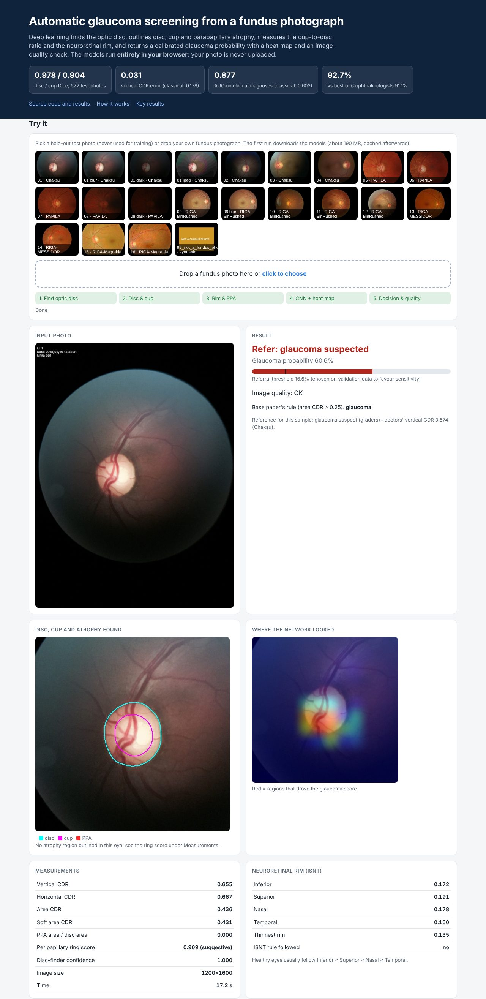

# Glaucoma Detection using Deep Learning

**Automatic glaucoma screening from a single fundus (retina) photograph.** The system finds the optic disc, outlines the disc, cup and parapapillary atrophy (PPA), measures the cup-to-disc ratio (CDR) and neuroretinal rim, and returns a calibrated glaucoma probability with a heat map and an image-quality warning.

### ▶ [Live demo: try it in your browser](https://madhur0770.github.io/Glaucoma-using-DL/)

Pick one of the 22 held-out test photos or drop your own. All six networks run **inside the browser** (ONNX Runtime Web / WebAssembly), so no server is involved and the photo is never uploaded. The first run downloads about 190 MB of models, which are cached afterwards.



---

## Highlights

| | Classical image-processing pipeline | **This system** |
|---|---|---|
| Optic-disc localisation (522 test photos) | 92.0 % | **100 %** |
| Disc Dice / Cup Dice | 0.771 / 0.448 | **0.978 / 0.904** |
| Vertical CDR error (MAE) | 0.178 | **0.031** |
| Glaucoma AUC on clinical diagnoses (411 eyes, Chákṣu + PAPILA) | 0.602 | **0.877** |

* **Comparable to ophthalmologists.** RIGA-BinRushed has 191 eyes, each graded by six ophthalmologists. Our out-of-fold accuracy against the consensus label is **92.7 %**. The best single doctor scored 91.1 % and the six-doctor mean was 84.5 %.
* **Matches published work.**
  * Cup Dice 0.904 (REFUGE state of the art: 0.901)
  * Mean disc+cup Dice 0.941 (published: 0.905)
  * vCDR MAE 0.031 (published: 0.039)
  * PPA Dice 0.849 on PALM (published: 0.815)
  * These comparisons use different test sets; see [`results/tables/scorecard.csv`](results/tables/scorecard.csv).
* **Robustness.** The system was evaluated with leave-one-dataset-out testing, under blur, darkening, JPEG compression and noise, with 5-fold CV, DeLong tests and calibration. An uncertainty-based quality flag catches unreliable photos.
* **Honest reporting.** On the original 39-image split of the classical study we tie its accuracy (94.9 %) and beat its specificity (0.96 vs 0.88). Its 100 % sensitivity is not matched (0.92), and both systems are well within the noise of a 39-image test. Every number in this README comes from a CSV in [`results/tables`](results/tables).

## How it works

```
fundus photo
  └─ 1  Localise   U-Net (ResNet-34) on the whole photo → optic-disc centre & size
  └─ 2  Segment    U-Net on a 3× disc-diameter crop → disc + cup;  U-Net++ on a tight 1.5× crop refines the cup
  └─ 3  Measure    vertical / horizontal / area CDR, rim width along 360 rays (ISNT rule)
  └─ 4  Atrophy    PPA U-Net (trained on PALM) + ResNet-18 that reads the peripapillary ring
  └─ 5  Decide     ResNet-50 on the disc region (with class-activation heat map), fused with CDR and rim
                   widths by a calibrated logistic model (threshold chosen on validation data for sensitivity)
  └─ 6  Check      entropy of the disc/cup boundary, disc-size sanity and localiser confidence → quality warning
```

Training and evaluation used 2,578 photos from **RIGA** (BinRushed, Magrabia and MESSIDOR, each outlined by six experts), **Chákṣu** (an Indian population, 1,345 photos) and **PAPILA**. **PALM** was used for the PPA model. Train/validation/test splits are by patient. The test photos in the demo were never used for training.

## Repository layout

```
docs/                 the live web demo (GitHub Pages): index.html, app.js, ONNX models, sample photos
app/screen.py         command-line screening with the same ONNX models (no PyTorch, no GPU)
scripts/              full research pipeline, numbered in run order
  01, 07              download public datasets          10        build the master table and splits
  20                  classical baseline (re-implemented) 30, 35, 45, 47  segmentation models + end-to-end Dice
  40                  glaucoma classifiers & fusion        50, 70    PPA models and domain adaptation
  60, 62              original-study protocol, ophthalmologist comparison
  80, 85              calibration, DeLong, CV, Grad-CAM, robustness, leave-one-dataset-out
  95                  scorecard            predict.py / demo_app.py   PyTorch report generator and local demo
tools/                ONNX export (TTA built into the graph) and fp16 / int8 weight compression
results/tables        every metric reported above (CSV)
results/figures       ROC curves, Bland–Altman, calibration, robustness, qualitative examples …
```

## Run it yourself

**Web demo locally**

```bash
git clone https://github.com/madhur0770/Glaucoma-using-DL && cd Glaucoma-using-DL
python -m http.server 8000 -d docs        # open http://localhost:8000
```

**Command line** (Windows / macOS / Linux, CPU only)

```bash
pip install -r app/requirements.txt
python app/screen.py docs/samples/04.jpg  path/to/your/photos/
# 04.jpg: REFER (glaucoma suspected)  p=0.521  vCDR=0.577  area CDR=0.385  ring=0.229  quality: none
```

The command writes a `<photo>_result.json` with every measurement.

**Reproduce the research** (GPU recommended)

```bash
pip install -r requirements.txt
python scripts/01_download.py && python scripts/07_download_extra.py   # public datasets
python scripts/10_build_master.py
python scripts/20_classical_baseline.py
python scripts/30_train_segmentation.py   # … then the remaining scripts in numeric order
```

RIGA originals are not redistributed. Place them in `raw/RIGA` or set `RIGA_ROOT`. Datasets and trained `.pt` checkpoints are not stored in the repository; only the compressed ONNX models used by the demo are.

## Tech stack

PyTorch · segmentation-models-pytorch · timm · OpenCV · scikit-learn · ONNX / ONNX Runtime Web (WebAssembly, multi-threaded) · vanilla JavaScript · GitHub Actions + Pages

## Author

**Madhur Kumar Rana**, MNNIT Allahabad
Supervisor: Prof. Dharmendra Kumar Yadav

Two manuscripts based on this work (an implementation study and a systematic review) are in preparation.

> **Disclaimer:** This is a research prototype, not a medical device. Any finding must be confirmed by an ophthalmologist.
